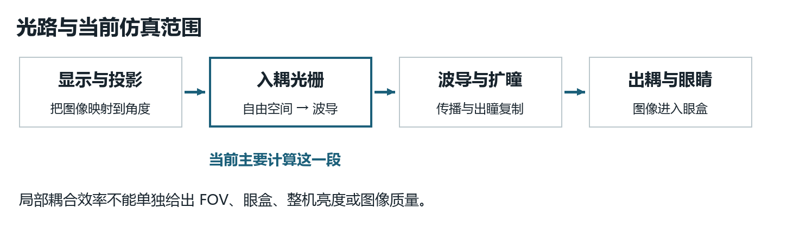
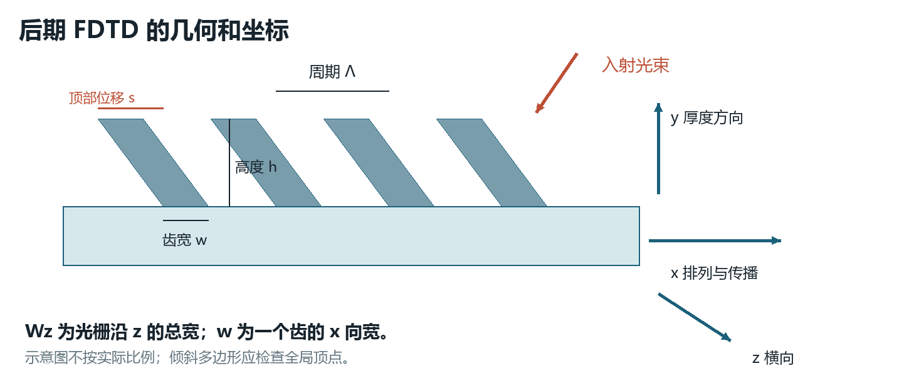
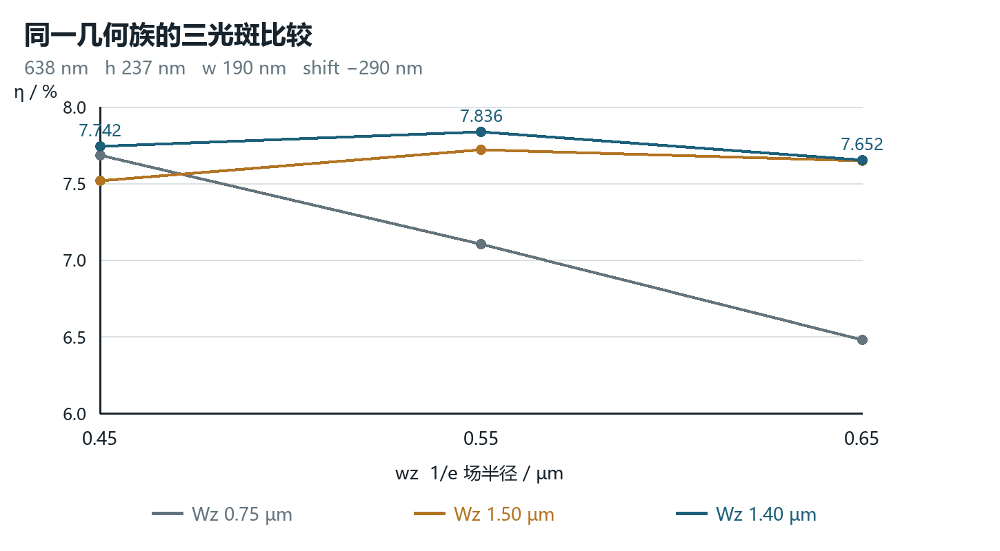

# AR波导光栅设计学习手册

从第一次建模到三维入耦候选验证

整理日期 2026年10月22日

这份手册把已有工程记录重新组织成可以学习、查证和继续操作的资料。我们的长期目标是理解 AR 波导光学系统；目前实际完成的工作主要围绕一个单色表面光栅入耦器。当前最值得做的是把模型、物理量和判断方法连起来，掌握一个能够自己解释的完整实验。

先回答你的困惑：工程计算已经推进得很深，但独立理解与操作没有同步验证。大量脚本替你完成了设置、求解、读取和决策，几次模型与评价指标的更换也没有充分解释。这个教学安排确实增加了理解难度。后续以你能讲清和复现为进度标准，不再以 Stage 编号或仿真次数为进度标准。

本次整理检查了本地学习记录、阶段报告、结果 JSON 和关键脚本；没有重新运行电磁仿真。文中“已完成”表示相应历史计算及记录存在，不表示你已能独立完成，也不表示所有结果已经达到产品验收标准。早期记录与现行解释不一致的地方，在相应章节明确更正。原记录保留在档案中。

## 阅读目录与使用方法

第一次阅读建议按 01 → 02 → 04 → 05 → 15 → 20 的顺序，先弄清对象、参数和当前任务。第二遍按正文顺序补物理与历史。需要查某个 Stage、模型、脚本或原始结论时，使用同目录的“学习导航.html”和“阶段文件索引.md”。

| 章节 | 你要解决的问题 | 当前学习位置 |
|---|---|---|
| 01 当前进度 | 工程究竟做到哪里了 | 必读 |
| 02 系统全貌 | 入耦器在 AR 眼镜中做什么 | 需要补牢 |
| 03 光学基础 | 角度、级次和相位匹配怎么算 | 已接触，需独立练习 |
| 04 参数与坐标 | 每个数值到底改变什么 | 必读 |
| 05 指标与读图 | 为什么不同效率不能直接比较 | 当前核心 |
| 06 求解器选择 | RCWA、FDTD、Bloch 各解决什么 | 已用过，需整理 |
| 07 操作与脚本 | 代码如何改到界面并产生结果 | 需要手动复现 |
| 08 至 15 历史复盘 | 每一阶段为什么开始和结束 | 按问题回看 |
| 16 当前结果边界 | 哪些证明已经有，哪些还缺 | 工程验证入口 |
| 17 错误与修正 | 以后怎样避免相同错误 | 随用随查 |
| 18 工作方法 | 怎样设计一个有效的小实验 | 下一轮执行规则 |
| 19 后续计划 | 怎么从局部元件走到 AR 系统 | 有限范围推进 |
| 20 下一课 | 今天具体学什么和怎么验收 | 从这里重新开始 |
| 21 自测与答案 | 怎样证明自己理解了 | 每课用一次 |
| 22 文件与参考资料 | 数据在哪里，如何恢复 | 保存与查证 |

## 01 当前到底进行到哪一步

当前项目停在“638 nm 三维有限光束入耦候选的局部验证完成，准备建立工程波长响应”。1.40 µm 是选作继续学习的横向宽度候选，不能称为通过全部工程验收的最终器件。10月17日的 Stage292–298 已计算完；最后一个操作问题是导入光源没有 `angle theta` 属性。此问题属于读取方式错误，不代表历史仿真结果丢失。

| 模块 | 已有工程证据 | 尚需建立的能力或证据 |
|---|---|---|
| 基础几何与界面 | 多版 FDTD 与 RCWA 工程、手动和脚本操作 | 不看代码说明也能指出每个对象作用 |
| 周期单元筛选 | 532/638 nm、TE/TM、周期、宽高与 k 向量测试 | 理解级次标签及两种 RCWA 归一化 |
| 二维有限器件 | 相位匹配、倾斜齿、角度与波长、部分公差验证 | 解释二维假设，知道结论适用哪一版几何 |
| 三维有限光束 | 背景场扣除、固定模态投影、局部几何和三光斑比较 | 源物理一致性和当前候选的针对性收敛审计 |
| 工程验证 | 已有实验流程与输入规格表 | 当前 1.40 µm 候选的波长、角度、位置及制造容差 |
| 完整 AR 系统 | 已讲过 FOV、眼盒、RGB、扩瞳概念 | 系统模型、出耦均匀性、RGB 共视场和成像质量 |

文件事实：工程基准 `ar_incoupler_ENGINEERING_BASELINE_638nm.fsp` 已存在，最后写入时间为10月17日19:25。它是切换 Layout 后保存的设置副本，不能假定包含原完整结果。已计算模型和后处理模型另存为 Stage292b、Stage293b 等文件。10月22日本次进程检查没有发现 FDTD 进程；这里记录的是保存状态，不能据此声称软件正在显示某个模型。

建议的当前定位是：已有较丰富的仿真实践和候选结果，正在补足独立判断能力。过去用“已经学会”或粗略百分比衡量进度并不可靠。之后要靠复述、预测和小实验验收。

## 02 把局部光栅放回完整 AR 光路

显示光机产生携带图像信息的光。准直与投影光学把图像位置映射到角度。入耦光栅改变光的面内动量，把合适的光送入波导；光在波导中传播，扩瞳结构把出瞳复制到更大的区域，出耦结构再把光送向眼睛。眼睛在一定眼盒内应看到完整图像。



当前计算主要覆盖“投影光束照到一小段入耦光栅，右侧产生多少导模功率”。这还没有包含显示器辐亮度、全片传播、出耦器、眼盒、眼球和成像链路。厘米级系统应由局部电磁数据与系统级传播模型衔接；把整个眼镜用纳米网格直接算一遍并不是合理的初学任务。

| 系统指标 | 它回答的问题 | 当前局部 FDTD 能否独立给出 |
|---|---|---|
| 入耦效率 | 入射光有多少进入指定传播通道 | 可以在明确模型与归一化后评估 |
| FOV 视场 | 能看到多大角范围的图像 | 不能，局部接受角只是一个限制因素 |
| Eyebox 眼盒 | 眼睛移动到哪些位置仍能看到完整图像 | 不能，需要扩瞳和出耦布局 |
| Eye relief 出瞳距离 | 波导到眼睛工作位置的距离 | 不能由局部光栅效率推导 |
| 均匀性 | 不同视场及眼盒位置的亮度是否一致 | 需要空间与角度联合评价 |
| MTF 与分辨率 | 图像细节传递得怎样 | 需要完整成像与波前分析 |
| 彩虹与鬼影 | 环境光和寄生路径是否产生可见伪像 | 需要相应杂散路径和照明模型 |

你的汽车信号灯经验能帮助理解功率流、均匀性、公差和测量闭环。需要补充的关键是波动光学中的相位、衍射通道、偏振和波导模式。先把这些接上，再扩展到系统设计。

## 03 先掌握四个物理关系

### 全反射是传播条件

角度必须说明相对哪个方向测量。这里把内部入射角定义为相对界面法线的角度。只有从高折射率介质射向低折射率介质时，才有通常意义下的全反射临界角。

$$\theta_c=\arcsin(n_2/n_1)$$

以波导 n₁=1.8、空气 n₂=1 为例，θc=arcsin(1/1.8)≈33.75°。内部角超过它，且界面、材料及传播条件符合假设，才满足该界面的全反射条件。一个高折射率对象命名为“substrate”，不等于它是低折射率包层；必须查看实际材料与边界。

### 光栅改变面内动量

沿 x 排列、周期为 Λ 的一维光栅，其倒格矢大小为 2π/Λ。选择一套固定坐标约定后，可以写为：

$$n_{out}\sin\theta_{out}=n_{in}\sin\theta_{in}+m\lambda/\Lambda$$

m 是整数衍射级次。+1 与 −1 的区别是增加还是减少该坐标方向的面内动量；它们不是“好级次”和“坏级次”。把 x 轴反向，标签可能随之交换，真实光路并未因此变坏。

最早的练习是假设空气正入射、532 nm、n_out=1.8、目标内部角50°。代入得到 Λ=532/(1.8×sin50°)≈385.82 nm。0级没有增加这部分动量，通常不能把空气中的自由传播光直接匹配到平板的束缚导模。棱镜、近场等其他耦合方案另有机制，不能把这个判断扩大为“0级永远没用”。

求输出角时先算反正弦的输入，只有绝对值不超过1才对应该均匀介质中的传播级。相同周期下，蓝、绿、红光的角度不同；早期练习中的约65.6°只是某一组参数的红光角，不是彩虹纹的统一发生阈值。

### 真正的导模匹配要用传播常数

$$\beta=k_0n_{eff}=k_{x,in}+mG$$

材料折射率 n 和模式有效折射率 n_eff 不是同一个量。n_eff 取决于截面、波长、偏振和边界。光栅加载还会改变局部传播与散射相位，所以裸波导 n_eff 给出的是起点，不能保证有限光栅最高效率恰好位于这个估计点。

当前参数的手算检查：λ=638 nm、Λ=328.75 nm、θ=−15.1°，空气入射且按这里的+1约定，所需相位折射率约为 sin(−15.1°)+638/328.75≈1.679。它表示相位匹配要求，不是本次独立求得的模式 n_eff。历史 Stage199 用三组波长与峰角反算，得到约1.6796，并检查了与裸波导色散的关系。

### 偏振必须联系场和坐标

相对于平面波的入射面，s/TE 的电场垂直于入射面，p/TM 的电场平行于入射面。波导模式的 TE-like/TM-like 还取决于传播轴和软件定义，应结合场分量、TE fraction 和模式剖面核验。`polarization angle=90°` 不能脱离模型复制到任何窗口；`mode1` 也不永久等于 TM。

本课验收：你能指出界面法线、x轴、传播方向，并说明选定的 m 为什么把光送向目标方向。先能画出箭头，再谈哪个级次效率最高。

## 04 参数和坐标的统一字典

后期有限 FDTD 的主要坐标约定是 x 沿光栅排列和波导传播，y 为厚度与上下方向，z 为横向。早期 RCWA 有过不同传播轴和二维截面；把 RCWA 的 z 尺寸抄到后期 FDTD 的 z 之前，必须做轴映射。



| 参数 | 当前候选记录 | 它改变什么 |
|---|---:|---|
| 波长 λ | 638 nm | 频率、传播常数、材料响应及入射相位 |
| 周期 Λ | 328.75 nm | 相邻齿的相位关系和倒格矢 |
| 齿宽 w | 190 nm | 元胞填充比例、散射强度及相位 |
| 占空比 d | 约57.79% | d=w/Λ，此处来自190/328.75 |
| 齿高 h | 237 nm | 结构扰动强度与散射相位 |
| top shift s | −290 nm | 齿顶相对齿底的x向位移，改变不对称性 |
| 齿底位置 | −3.75 nm | 定义高度扫描时固定的物理界面 |
| 横向光栅宽度 Wz | 1.40 µm | z向有限口径；与单个齿的x向宽度不同 |
| 齿数 N | 24 | 有限阵列长度、相干累积和光束覆盖 |
| 入射角 θ | 历史生成源为−15.1° | 入射场的面内相位斜率 |
| wx | 历史源设置6 µm | x向光束参数，正式使用前应核对源的定义 |
| wz | 名义0.55 µm | z向1/e场半径，端点0.45与0.65 µm |
| 报告面 | 历史沿用x=7 µm | 在哪里读取右行场及模式分解 |

“齿宽190 nm”和“光栅宽1.40 µm”属于不同方向。`x span` 是沿x轴的包围范围；多边形的倾斜形状还由顶点定义，不能仅凭一个 span 断定实际顶部、底部线宽。24个齿的 NΛ 约为7.89 µm，但包括倾斜顶点的实际边界必须由几何坐标计算。

若固定 w=190 nm 扫周期，占空比会随之改变；若固定占空比扫周期，必须同步改变齿宽。这两种扫描回答不同问题。类似地，固定 top shift 改齿高会改变侧壁倾角；如果固定侧壁角，应同步改变 shift。所谓“只改一个变量”，首先要讲清保持的是哪一组物理约束。

单位换算：1 µm=1000 nm；638 nm=0.638 µm=6.38×10⁻⁷ m。软件内部以米表示长度很正常。网格5 nm不是5 mm，两者相差一百万倍。对象名 `mesh_grating_10nm` 可能保留旧名，实际 dx、dy 应从属性读取。

在当前z包络中，场幅按 exp[−(z/wz)²] 变化，强度按 exp[−2(z/wz)²] 变化。因此 wz 同时是1/e场半径和1/e²强度半径；强度 FWHM 全宽约为1.1774wz。wz=0.55 µm 对应强度FWHM约0.648 µm，不能把0.55 µm直接当作光斑直径。

## 05 到底应该读哪一个效率

报告效率前先写一句话：“在什么模型、什么输入下，进入什么通道的功率，除以什么入射功率。”漏掉其中任何部分，两个百分数都可能无法比较。

| 量 | 物理含义 | 常见误用 |
|---|---|---|
| 电场强度图 | 各位置的场幅平方分布 | 把颜色最亮处当成最高传输效率 |
| signed T | 监视面上有方向符号的净功率除以指定源功率 | 对各面取绝对值后相加做能量守恒 |
| 一级衍射功率 | 周期结构向某个平面波级次分配的功率 | 直接称为有限波导导模效率 |
| mode1效率 | 指定本征模式的前向功率比例 | 把模式编号永久等同于TM或+1级 |
| 总导模前向 | 所选导模集合的前向功率和 | 与净值混用或把所有PML模式都加进去 |
| 总导模净值 | 前向导模功率减去后向导模功率 | 不说明背景扣除与分母 |
| 模式占比 | 目标模式功率除以导模前向总功率 | 把78%占比说成78%入耦效率 |
| 眼盒效率 | 到达指定眼盒、角域和位置的有效光功率比例 | 用局部7.836%代替整机效率 |

电磁功率流由时均 Poynting 矢量计算：S=½Re(E×H*)。面功率应积分法向分量，符号来自所选法向。x-normal面用Sx，y-normal面用Sy；只有在相同截面、覆盖范围、归一化和方向约定下，数值才可直接对比。

当前7.835999%的完整含义是：在记录的638 nm、有限椭圆导入源和1.40 µm横向光栅条件下，用匹配无齿参考扣除复场，再投影到同一模式基底，按脚本导模筛选条件求得的右侧散射导模净功率，占导入场直接积分入射功率的比例。它是当前模型的局部指标。

这个名义点的 mode1 前向效率是6.118999%，mode1占前向导模约78.0839%。因此“6.119%”“7.836%”“78.084%”同时成立：分子和分母不同。

当前直接积分入射功率约6.8076×10⁻¹⁵ W，净导模功率约5.3344×10⁻¹⁶ W。仿真场幅可以按线性系统缩放，fW数量级不表示真实投影光机只有如此小的功率。若在同一线性模型中把入射功率设为1 mW，7.836%对应约78.36 µW；这是比例换算，不是已测得的产品输出。

读图顺序：先看坐标轴和单位，再看属性、波长、偏振与级次/模式标签，最后看数值与归一化。|E|² 应由三个复场分量的模平方相加；不等于把复数E先平方，也不等于只看某一个分量。dB图主要显示动态范围，不能代替功率积分。

## 06 RCWA FDTD 与 Bloch 为什么轮流使用

| 方法 | 最适合回答的问题 | 关键假设或局限 | 应检查的数值参数 |
|---|---|---|---|
| 光栅方程与手算 | 级次能否传播、方向大致在哪 | 不给出完整耦合效率 | 坐标、介质、角度定义 |
| RCWA | 周期元胞的偏振与衍射分配 | 横向周期重复，通常为平面波激励 | 傅里叶谐波数、层划分 |
| 二维有限 FDTD | 有限齿数、边缘、局部模式耦合 | 一个方向不变，不能表示有限z光斑 | 网格、时间、边界、报告面 |
| Bloch单元分析 | 周期加载结构的色散与共振 | 本征性质不等于有限器件效率 | Bloch波矢、网格、时间 |
| 三维有限 FDTD | 有限宽度、真实横向光束和三维散射 | 成本高，源与模式测量更复杂 | 三向域与网格、源、模式集合 |
| 系统级光学模型 | FOV、眼盒、出耦、成像和杂散路径 | 需要局部元件数据或等效模型 | 角谱/功率插值与系统采样 |

RCWA把周期介质和场展开为傅里叶谐波，适合快速筛选；FDTD在时间与空间网格上求电磁场，适合有限结构。它们都求解电磁问题，但模型边界不同。[O1]

RCWA的“max number k vectors”控制保留的谐波数量，是数值精度旋钮；光栅方程中的k或G是物理波矢。二者不能混为“优化k就是优化器件”。收敛时应固定结构，只增加谐波数，观察目标结果是否稳定。

合理流程是：用手算给初值，用低成本模型找趋势，用与目标器件一致的模型验证少量候选。更换二维、三维或光源时，应先做模型差异审计。不能假设旧最优点或旧容差窗口在新模型中必然成立。

## 07 界面和代码如何对应

| 界面动作 | 常见脚本 | 是否启动电磁求解 |
|---|---|---|
| 查看对象属性 | `getnamed` | 否 |
| 修改对象属性 | `setnamed` | 否 |
| 切换到Layout | `switchtolayout;` | 否，但会移除当前分析结果 |
| 点击Run | `run;` | 是 |
| 读取已有结果 | `getresult`、`getdata` | 通常否 |
| 更新模式 | `updatemodes` | 求模式，不等于重跑整个FDTD |
| 执行脚本文件 | `feval("...lsf");` | 取决于文件内容是否含run等操作 |
| 保存模型 | `save("...fsp");` | 否 |

在 Script Prompt 输入一组变量，不会自动扫描。自动扫描通常是循环“设置参数→校验→保存设置→run→读取→保存结果”。Python通过 lumapi 可以向软件发送同样的脚本；后台运行只是换了操作入口，物理求解并没有变成另一种方法。

Apply应用设置但保留对话框，OK通常应用设置并关闭。按E打开已选对象属性、双击是否打开，受实际界面和焦点影响；遇到无响应先确认选中的是什么，不应无依据推断版本有故障。

`.fsp`保存工程及可能包含的计算结果；`.lsf`是可执行脚本；`.ldf`保存脚本变量；`.json`和结果表适合机器与人工读取；`.md`解释结论。文件名含COMPLETE、FINAL或ADOPTED不等于内容已验收，仍需核查保存状态和结果对象。

最稳妥的学习节奏是先在界面完成一个参数的查看或修改，再用一行代码读回，说明预测，最后才运行。后处理脚本也要先看开头：其中的 `load()` 可能切换模型，`switchtolayout` 可能清除未保存的结果，不能把所有 `feval` 都当成只读。

## 08 最早阶段的学习与有限阵列练习

最开始学习的是532 nm、n≈1.8的几何光学关系：全反射、目标传播角、光栅周期、RGB色散和级次方向。随后建立FDTD区域、材料、单条光栅、平面波、网格和功率监视器，逐步熟悉单位、Layout/Analysis及Visualizer。

对话中早期出现过67%占空比、约4.2%读数、210 nm高度、324–332 nm周期扫描和335 nm候选。它们属于不同模型及读取阶段。本次不把这些零散数值串成一条已核验的性能曲线；原PPT和工程文件可在索引中查到。它们最适合用来回忆操作顺序。

之后做过9条渐变光栅和 `power_y_01` 到 `power_y_10` 的截面比较，包含约45%到70%的占空比渐变，以及0.80–1.00 µm间距扫描。8月18日记录的手动1.000 µm结果是U≈55.1816%、sum≈1.20874；8月17日有符号T出现反转。

这些结果适合作为“比较截面数据和识别功率符号”的练习，不能直接证明扩瞳眼盒均匀性。沿同一传播路径放置的多个截面，可能反复统计同一束光；把各截面功率相加不一定是互不重叠的总出耦功率。对负功率取绝对值也不能自动修复反向传播与干涉问题。

需要更正两处早期记录。第一，若 `P` 是标准矢量数据集，形状322×1×1×1×3表示322个x点、单一y/z/f点以及最后的三个矢量分量，不能把末尾3叫三频点。第二，空间积分需同时明确数组维度和坐标；不能把 `integrate(p_line)` 或 `integrate(qP,1)` 当作通用、已验证的空间功率公式。[O4][O5]

本阶段应该带走的是：先辨认数据，再计算指标。真正的均匀性需要定义互不重叠的空间/角度采样、相同权重和有效正功率，然后才有意义地讨论 min/max 或其他指标。

## 09 RCWA阶段从绿光筛选到红光约束设计

8月25日记录形成了532 nm周期单元候选：周期335 nm、占空比51%、齿宽170.85 nm、高度290 nm、theta=−14°。历史读取 `grating_orders` 的目标n=+1，TM为43.2420、TE为43.4901，记录中的双偏振分数为两者较小值43.2420。这里先按历史数据口径保留数值，下面会说明归一化更正。[S1]

双偏振最小值适合“两个偏振都要满足要求”的保守筛选。它不等于非偏振光平均效率；等功率非相干混合时通常取两者平均。若光机有明确偏振权重，应按实际输入定义指标。

固定335 nm几何，历史 `grating_orders` 指标的RGB对比如下。红光明显较低，促使我们调整周期，而不是仅继续调高度。[S2]

| 波长 | TM目标级指标 | TE目标级指标 | 较小值 |
|---:|---:|---:|---:|
| 450 nm | 59.7657 | 57.9004 | 57.9004 |
| 532 nm | 43.2420 | 43.4901 | 43.2420 |
| 638 nm | 3.1385 | 10.5295 | 3.1385 |

为了大致保持48.4°内部传播角，红光周期初估约402 nm。实做过400 nm以及380、390、400、410、420 nm粗扫；407 nm在当时±1°教学角度约束内，输出角约47.432°。408 nm越过该约束，说明最高指标并不自动满足系统目标。

在407 nm、51%占空比下高度优化到243 nm，历史TM/TE指标约25.3058/25.3666。k向量40/60/80/100/120/150的比较中，以150为参考，100档TM差约0.0245个百分点，60档差约0.0947个百分点。旧记录采用0.1个百分点作为教学收敛线；这不是所有结构通用的标准。[S3]

9月1日进一步把名义偏振平衡、±5 nm宽高扰动、输出角余量放在一起比较。−14°虽有较高指标，但输出角接近约束边界；−13°更居中。后续形成过407 nm、齿宽约210 nm、高度175 nm的红光RCWA候选，作为有限FDTD的起点。[S4]

这里有一项重要更正。Ansys文档明确：`grating_power` 是各衍射级占总入射功率的比例；`grating_orders` 使用不同归一化，二者关系为 grating_order=grating_power×n_in×cosθ_in。两者都可带级次标签。旧教学中把“具体效率只能看orders”说得过于绝对，需要修正。[O2]

因此，历史表适合按原口径追溯，但今后要用 `grating_power` 报实际级次功率比例，并在同一角度、介质、偏振、频率下检查关系。固定角度时共同的比例因子不改变候选排名；扫角度或介质时，比例因子也变，必须重新核算。不能把不同归一化的数字混入同一张效率表。

## 10 有限二维FDTD为什么一开始读不稳

9月1日建立有限8齿模型：638 nm、407 nm周期、210 nm齿宽、175 nm齿高及10 nm局部网格。主仿真完成过，但 `mode_right` 的Calculate报错、`power_top`结果不可读；这说明“求解结束”和“后处理有效”是两个检查点。随后将模型坐标从早期x-z映射到x-y，重新检查偏振、模式截面和监视器关联。[S5]

有限模型中，右侧功率监视器会看到穿过截面的所有场。斜入射平面波、辐射、近场或背景可能混入。早期优化得到的408 nm、53%占空比、235 nm高度等，曾依赖尚不稳定的模式读数，只能视作当时的候选。

Stage39改用Gaussian源后，距光栅0.8/1.0/1.2 µm处的TM前向读数仍分别约0.02393%、0.01829%、0.00853%。Stage40–41把公共区域扩大到16 µm，再测2/3/4 µm，读数约0.02623%、0.02118%、0.01031%，仍明显随位置变化。右侧总功率却较稳定，因此应检查模式、截面和材料，而不能继续按最高读数调几何。[S6]

Stage42–44检查边界与RCWA层映射。Stage44脚本明确设置core与substrate均为n=1.8，历史合计高折射率厚度达到850 nm。一个对象名叫“300 nm core”，并不意味着整个实际导光层只有300 nm。后续基底延伸到PML的设置也会影响“模式究竟是否物理束缚”的判断。

Stage45采用当时求得的TM基模 n_eff≈1.64452，结合638 nm、−13°计算初始周期约341.27 nm，再做有限器件扫描。这一转折的逻辑是：先确定传播通道和测量方法，再寻找几何最优点。

## 11 Stage46至104完成了哪些物理验证

Stage46–54对周期、占空比和高度作粗细扫描；Stage55–56核对网格精度；Stage57–68研究波长范围以及周期、占空比、高度单变量扰动。Stage69–72把多个制造误差同时组合，因为每个参数单独可接受，不代表误差一起出现时仍可接受。

Stage73–80研究角度与波长联合响应及相位匹配。Stage81–90使用Bloch单元进一步解释响应峰：历史报告给出约638.1±0.1 nm共振，Bloch预测入射角−12.9796°与有限12齿最佳角−13.0358°相差约0.0562°。这是一项“峰值来源”的交叉验证，不是又一种整机效率。[S7]

Stage91建立闭合功率框，历史右行TM约25.5208%，相对于当时右侧总功率的模式占比约99.71%；还发现明显向下功率。旧报告把顶面净流入直接当作纯入射功率时，应保留限定：存在反射时顶面净通量包含入射与反射的合成，不能不经分离就等同于源入射功率。[S8]

Stage92增加底部区域0.5 µm后，右行TM只变化约0.0088个百分点，说明当时主要向下功率不是单纯靠加深区域就能消除。随后Stage93–95研究倾斜/非对称光栅；5 nm与3.5 nm网格的TM约43.4619%与43.5041%，差约0.0422个百分点。[S9]

Stage96–104继续局部高度、shift、占空比和带宽比较，形成过约58%的历史读数。后续源状态与带宽审计改变了可靠比较条件；本手册不把这段历史读数与之后修正源得到的32%或最终三维7.8%直接比较。

这一阶段要掌握三种不同问题：峰为何出现由相位匹配解释；能量去哪里由功率账本解释；数值能否信由收敛实验解释。只有最后一个问题通过，前两个解释才有可靠基础。

## 12 Stage105至199形成二维设计闭环

Stage105发现不同入射角得到相同结果，排查到Gaussian `source` 被禁用。光源自身的预览场会变化，并不保证它参与求解。启用后再运行，并由源场相位斜率验证0°与−20°，后者反算约−19.9981°。这解释了“我改了参数为什么结果不动”。[S10]

Stage107–112在有效源条件下重做角度、波长与周期联合比较。335.5 nm周期、−13°、638 nm的历史TM约32.4016%；波长峰约627.09 nm。周期改到334 nm后联合角度约−13.6°，3.5 nm网格结果约32.8656%。公式提供初值，有限结构的相干叠加和光束覆盖决定实际响应，不能只按波长比例机械放大周期。

Stage113–143开展能量、监视面、制造误差与稳健中心研究。旧公差窗口最低余量很小，调整中心后，历史16个角点均满足95%保持率，最差约96.40%。这说明优化可以改变“对误差的敏感性”，而不只是提高名义点。[S11]

Stage144–158检查新中心的角谱响应并扩展齿数，进入24齿阶段；周期和角度也重新变化。Stage159高度扫描曾漏同步对象中心，导致向下侵入波导：那次高值不能当作纯齿高优化成果。Stage160起固定齿底−3.75 nm，再比较宽、高、shift和周期。[S12]

Stage175–181是另一项关键审计。同一旧二维结构，源span=20 nm时中心读数约78.37%，span明确设为0时约59.9241%。这是激励设置不同产生的差异，不能记录为几何提升。FDTD宽带本身并非不能用；必须确认频率相关场形、入射条件、归一化与逐单色结果一致。后来单色扫描成为可比基准。

Stage182–192最终二维候选记录为：Λ=328.75 nm、w=185 nm、h=310 nm、shift=−240 nm、24齿、−15.1°、638 nm、3.5 nm生产网格。mode1约60.6064%，TM前向和约62.0770%，直接右侧约61.8808%。mode1和高阶mode3对报告面有互补变化，因此需要同时报告单模、总导模和直接功率。

Stage193–199在该二维几何上得到历史3 dB角宽约5.4133°、固定角度单色3 dB波长宽约27.538 nm，并用波长—角度脊线验证相位匹配。它们属于这版二维结构。当前三维1.40 µm、237 nm高度候选不能直接继承这些带宽和公差数字。

## 13 Stage200至229为什么转入三维测量重建

二维源与三维源的角度和偏振映射必须检查。Stage200–203先采用z周期桥接，验证phi方向、z网格、周期单元宽度和源归一化。dz从20降到10 nm对直接右侧功率影响很小；0.2变0.4 µm的周期宽度也基本不改变归一化结果，但二维与三维仍有约5.27个百分点差异。结论应是“内部某些数值设置已稳定，跨模型差异尚不能混报”。

Stage204–206比较8/16/32个模式。总模态和不完全等于直接功率，提示辐射连续谱与反向分量的存在。更多模式不保证所有新增模式都是应计入目标的导模。

Stage207把z方向改为有限宽和PML，直接右侧功率约6.4357%。检查发现横向边缘功率不衰减，斜入射无限平面波自身的x向通量也穿过输出面。于是Stage208建立完全匹配的无齿参考，Stage209做复场相减。[S13]

$$E_s=E_p-E_r\quad H_s=H_p-H_r$$

这里p是有齿总场，r是无齿参考，s是相对于参考的散射场。因为功率含E与H的乘积，P_p−P_r还包含干涉交叉项，并不一般等于P_s。必须先在一致网格、相位和源条件下减复场，再计算功率。相干分解重构接近机器精度只证明代数一致，不等于整个模型已经物理正确。

Stage210–220在同一模式基底上分别投影总场、参考场和散射场，并比较模式数及z域。平面波条件下按光栅宽换算的结果仍随域大小变化，因此停止无边界扩域，改用定义清楚的有限光束。

Stage221起导入椭圆场：取Stage198二维源的x分布、相位及E/H，再乘z向Gaussian包络。对比wz=0.45/0.55/0.65 µm时直接积分入射场作为归一化分母。旧结构的净导模指标约1%量级，不能与二维60%或RCWA级次值比较。[S14]

这里也保留一项物理限制：把二维E/H都乘以横向Gaussian包络，是当前使用的源构造方法，不自动等同于经过独立验证的严格三维聚焦光束。尤其wz与波长相近时，要检查传播方向、矢量场一致性、焦点和空域传播；导入数据功率积分可重现，并不能替代真实注入场验证。[O3]

本阶段最重要的成果是一套可追溯测量链：输入场→有齿与无齿参考→复场相减→同基底投影→指定导模求和→按同一入射功率归一化。

## 14 Stage230至280的几何优化是怎样决策的

先在当时的310 nm齿高和wz=0.65 µm下比较z向光栅宽度。0.75 µm附近得到较好局部结果，0.73与0.77 µm用于检查邻域与±20 nm扰动。这个局部最优是在当时高度、光斑和目标函数下成立的，不能推广成所有设计都应取0.75 µm。

随后本来只想验证齿高±10 nm。300、310、320 nm的净导模指标约2.1954%、1.3081%、0.6201%，趋势很强，说明310 nm在三维有限光束下不是稳健中心。于是以有限步数向下找峰，而不是直接做庞大全参数扫描。[S15]

| 齿高 nm | 净导模指标 % | 当时的判断 |
|---:|---:|---|
| 320 | 0.620073 | 比310明显差 |
| 310 | 1.308103 | 原二维迁移中心 |
| 300 | 2.195387 | 降低高度有效 |
| 290 | 3.108422 | 继续检查下降方向 |
| 280 | 4.018999 | 仍在上升 |
| 270 | 4.859499 | 仍在上升 |
| 260 | 5.564175 | 增益开始缩小 |
| 250 | 6.053978 | 继续夹峰 |
| 240 | 6.278298 | 接近峰 |
| 230 | 6.214362 | 出现下降，已夹住峰 |
| 237 | 6.287361 | 实跑验证局部候选后停止 |

此表固定Λ=328.75 nm、w=185 nm、shift=−240 nm、Wz=0.75 µm、wz=0.65 µm。不能把它和改变光斑后的结果混成一张纯高度曲线。237.38 nm拟合值不是另一次真实仿真，也不意味着制造必须做到小数点后两位。[S16]

高度改动后，用180/185/190 nm复核齿宽。总净导模分别约6.2433%、6.2874%、6.3000%；mode1在185 nm略高。选择190 nm意味着当前主目标偏向总净导模，而不是最大单模纯度。三点拟合建议约189.51 nm，预测余量很小，因此没有继续亚纳米扫参。[S17]

最后固定w=190 nm、h=237 nm，扫描top shift从−240到−300 nm。总净导模在−290 nm约6.4770%，−300 nm略低；mode1则约在−280 nm更好。选择−290 nm作为总净导模目标的候选，并保留−280 nm这一不同目标的备选。原Wz=0.75 µm条件下，shift±10 nm最差端下降约0.202%，是局部容差证据，不能自动套给后来1.40 µm版本。[S18]

## 15 Stage281至298的最后比较

此前几何主要在wz=0.65 µm下优化。为判断照明变化是否让设计失效，固定几何，比较0.45、0.55、0.65 µm三种光斑；再考察横向光栅宽度0.75、1.50、1.40 µm。这里改变的是几何对既定照明范围的适应性，而不是把光机规格当作任意可优化参数。

| 光栅Wz | wz 0.45 µm | wz 0.55 µm | wz 0.65 µm | 最大端点相对偏差 |
|---:|---:|---:|---:|---:|
| 0.75 µm | 7.684374% | 7.103324% | 6.477015% | 8.8171% |
| 1.50 µm | 7.516980% | 7.718562% | 7.646534% | 2.6116% |
| 1.40 µm | 7.742007% | 7.835999% | 7.652342% | 2.3438% |



端点偏差定义为100×[η(端点)/η(0.55)−1]。1.40 µm两端分别为−1.1995%与−2.3438%，所以临时“两个端点均在±2%内”的条件未通过。其三点最高与最低相差0.183657个百分点，除以名义7.835999%后得到2.343757%。这次两种指标数值相等，是因为名义点刚好最高；两种定义一般不等价。[S19]

0.75 µm的三点相对跨度约16.9971%，1.40 µm约2.3438%，按这种定义跨度减少约86.21%。这是稳定性指标的改进，不是效率提升86%。名义净导模相对原0.75 µm提高约10.31%；最差端提高约18.15%。

学习上的工程选择：采用1.40 µm作为继续验证的暂定候选，保留0.75和1.50 µm作对照。±2%是教学与筛选用的临时要求，缺少真实产品规格时不能据此宣布产品合格或不合格。也没有必要为了把2.3438%压到2.0000%而立即重启无尽优化。

注意三个光斑的输入功率随保持的场幅和光束面积而改变。效率降低时，绝对导模功率仍可能增加。比较“省光”应看归一化效率；比较实际亮度应先统一真实输入功率与光机条件。

## 16 当前结果已经证明了什么

Stage292–298结果JSON中的 `all_validation_gates_pass=true`，证明的是该脚本列出的检查通过，包括网格对齐、参考源一致、相干重构、投影线性、模式数设置和残差阈值。它不能扩大解释为所有数值、物理、制造与系统验证已经通过。

| 检查项 | 当前证据 | 本手册的判断 |
|---|---|---|
| 三点结果完整性 | 三组模型、后处理数据与汇总已保存 | 已有结果 |
| 数据对齐与复场重构 | 脚本检查通过 | 测量链内部一致性已有证据 |
| 模态投影线性 | a/b误差约机器精度 | 已有代数一致性证据 |
| 模态数 | 当前使用32模，脚本筛出28模 | 数量确定，物理导模分类仍需结合截面 |
| 当前候选全部网格与PML收敛 | 主要沿用早期设置 | 不应宣称本候选全部重新验证过 |
| 源场实际传播与频率更新 | 有构造脚本，当前638 nm | 波长扫描前必须完成源检查 |
| 三点照明±2% | 最大偏差2.3438% | 临时条件未通过 |
| 产品验收 | 光机、材料、公差目标待定 | 尚未具备产品结论 |

三个特别需要限定的地方。第一，当前脚本以 Re(n_eff)>1筛选“导模”；如果外侧介质、基底或PML截面不符合这个判据的物理假设，需结合场束缚、损耗与边界进一步分类。第二，残差小与0≤效率≤1只是必要检查，不是全部正确性的证明。第三，实际脚本中部分参考源功率是复用已知同一输入值；“比例为1”有时是输入一致的记录，不能当作两次独立测量相同的强证据。

这些限制不要求立刻重跑几百个Stage。先做一次有针对性的审计：查当前源与材料截面、复核一个名义结果、识别真正影响结论的检查，再决定是否需要补一个仿真。

## 17 反复出现的错误和正确处理

| 现象或旧说法 | 原因或限制 | 正确处理 |
|---|---|---|
| 导入源没有angle theta | 把标准源属性套到Imported Source | 查真实对象类型，方向从场数据与生成参数核验 |
| 改了角度结果不变 | 可能修改禁用源或仍读旧结果 | 检查enabled、保存状态、是否重新run |
| 638 nm称作绿色 | 表述错误 | 638 nm属于当前红光模型，早期532 nm为绿光 |
| mode1必是TM或+1 | 混淆模式编号、偏振与衍射级次 | 查neff、场剖面、TE fraction及传播方向 |
| orders就是实际效率 | 忽略RCWA归一化区别 | 用grating_power并核对入射功率定义 |
| 矩阵末尾3是三频点 | 混淆矢量分量轴 | 对照数据集x/y/z/f与属性维度 |
| sum多个截面当总效率 | 可能重复计数同一能流 | 定义不重叠输出面或闭合边界 |
| 对T取abs解决能量异常 | 丢失方向信息 | 先统一法向，再分离入射与输出 |
| 总场功率减背景等于散射功率 | 漏掉相干交叉项 | 先减复场，再做Poynting积分 |
| 文件叫FINAL就已完成 | 文件名不是验收证据 | 同时核查结果对象、参数和计算状态 |
| switchtolayout只是切个界面 | 它会清掉当前分析结果 | 先保留结果工程，另存设置副本 |
| run("某脚本") | run参数不是执行脚本路径 | 执行LSF用feval，先检查脚本内容 |
| 把源标签638改为628即正确扫描 | 导入相位和E/H未必随频率更新 | 每个频率生成匹配场或验证多频导入 |
| 增加高度只改多边形h | 对象中心没同步可能改变刻蚀深度 | 固定齿底并审计全局顶点 |
| 算出更高值就继续 | 没有目标、误差与停止规则 | 先说明本轮要验证什么及何时停止 |

最近的属性报错来自我给错对象属性，应该由我先查生成脚本和官方对象定义。对你而言，值得学习的排错方法是把错误分成对象不存在、属性不存在、结果不存在、维度不匹配、物理定义不一致五类。每次先确定属于哪类，再改最小部分。

## 18 每轮实验采用相同的推理顺序

一个可学习的实验只需要先写清七句话：问题是什么；基准文件是哪一个；固定哪些量；改变哪个量；预计怎样变化；从哪里读什么指标；什么结果意味着停止或进入下一步。

以高度实验为例：问题是“310 nm是否是三维稳健高度”；固定周期、齿宽、shift、光源和测量方法；先测300/310/320。结果单调说明峰未夹住，逐步下移；230/240/250夹住局部峰后，只补一个237 nm验证点。拟合帮助挑点，实测决定是否采用。

优化、敏感性与收敛应分别安排。优化主动改变设计，寻找更好指标；敏感性把偏差当作不可控误差，观察损失；收敛固定物理问题，仅改数值设置，检查答案稳定性。如果三者混在一个表中，无法知道效率变化来自哪里。

停止规则也要分开。教学理解以能复述与复现为准；局部优化以峰值范围、工程增益和数值不确定度为准；产品验收以明确规格为准。历史0.02个百分点、1%或±2%都是局部采用的阈值，没有一个是放之四海而皆准的标准。

对于后续练习，预先限定“3点检查，确有必要才加2点”。候选改善若与网格差、模式分解差或源差同量级，应停止微调并报告不确定度。当前不需要再优化周期、齿宽、齿高或横向宽度来证明学习进步。

每轮保存一张实验记录：问题、日期、模型版本、坐标与输入、唯一变量、原始结果、分母与单位、比较值、结论、限制和下一动作。自动脚本可以执行这张记录中的步骤，但不能替你省掉前面的预测和后面的解释。

## 19 后续如何进行

近期按六节课重建理解，每节建议60–90分钟。以下是主动学习时间建议，不含排队与电磁求解等待，也不是完成整机设计的承诺。

| 课次 | 核心任务 | 使用已有资料 | 验收产物 |
|---:|---|---|---|
| 1 | 画当前模型和光路，认清x/y/z | 第02、04章与基准工程 | 一张标注图 |
| 2 | 亲手解释7.836%、6.119%、78.084% | 第05、15章与结果JSON | 一张功率定义表 |
| 3 | 手算TIR、级次及相位匹配 | 第03章 | 两道完整数值题 |
| 4 | 只读检查导入源和对应数据 | 第07、17、20章 | 四项属性与源类型记录 |
| 5 | 回放一次高度三点实验 | 第14章与原始报告 | 预测、比较、停止理由 |
| 6 | 写一份工程波长验证计划 | 第16、18章 | 3点实验卡，不要求立即run |

上述约6–9小时若能独立完成，再进入当前候选的工程验证。先处理导入源：638 nm复现、场方向与功率检查；若要改变波长，应让源相位、E/H、参考模型、材料取值和模式基底一同对应新频率。先用628/638/648 nm三个教学点，必要时增加633与643 nm；实际产品需换成真实光谱范围。原计划的五点不会因为写在表里就自动完成。

得到波长响应后，区分“固定入射角下的带宽”和“每个波长重新寻峰后的上包络”。前者更直接反映固定装调条件；后者解释色散耦合。不能逐波长重新优化角度后，把结果称作固定系统的宽带性能。

后续依序检查小范围角度、光斑位置、所需偏振与制造偏差。尽量复用满足相同条件的参考，不满足时重新生成。只有单变量趋势清楚，才做少量组合角点；不先开大规模蒙特卡洛。材料色散、吸收和制造参数应明确为实物数据或教学假设。

再往后进入系统课程：入耦后的k空间与TIR通道，出耦光栅的方向选择，一维到二维扩瞳，眼盒与均匀性，RGB共视场，鬼影与彩虹路径，成像质量。先建立简化系统与功率预算，再决定局部光栅还缺什么性能。

没有真实光机规格也可以继续学习。应把638 nm、当前光束与角度写成明确的教学基准，把产品光谱、FOV、出瞳、偏振和制造能力保留待定。这样能完成一个可解释的仿真案例，同时诚实保留产品适用边界。

## 20 下一课从这里开始

下一课唯一目标：你能指着模型说明“光从哪里来、在哪里被测量、7.836%的分母是什么”。这节课无需长仿真。

先打开工程基准 `ar_incoupler_ENGINEERING_BASELINE_638nm.fsp`，确认对象树含 `elliptical_gaussian_3d`。若已有未保存工程，不要直接load覆盖它。确认没有正在求解的任务后，在Script Prompt执行同目录提供的只读脚本，或手动输入：

```lsf
?"custom_source_enabled = "+num2str(getnamed("elliptical_gaussian_3d","enabled"));
?"standard_source_enabled = "+num2str(getnamed("source","enabled"));
?"wavelength_start_nm = "+num2str(getnamed("elliptical_gaussian_3d","wavelength start")*1e9);
?"wavelength_stop_nm = "+num2str(getnamed("elliptical_gaussian_3d","wavelength stop")*1e9);
```

按已保存来源，预期是1、0、638、638。这是待你在当前界面确认的预期，不是本次已经远程执行得到的输出。若对象缺失，先核对打开的文件和对象树。此脚本不设置参数、不保存文件、不启动求解。

随后打开结果 `stage292_293_width1p4um_wz0p55_nominal_results.json`，找到 `guided_scat_net`、`mode1_scat_forward` 和 `mode1_fraction_guided_forward`，分别乘100，写下三个百分数。数据已在学习导航中放成可读卡片，不必肉眼估图。

最后用自己的话写四句：这是红光还是绿光；当前启用哪个源；总净导模与mode1有何区别；为什么还不能称作AR眼镜总效率。能答出这四句，再做第2课的功率账本。暂时答不出就回看第02与05章，不需要再增加Stage编号。

## 21 自测题与参考答案

先作答再看答案。可以口述，也可以把答案写在“我的实验记录.md”中。一次只检查本课相关的两三题。

1. 532 nm、n=1.8、正入射、目标内部50°，周期约多少？
2. 当前190 nm齿宽、328.75 nm周期，占空比是多少？
3. AR入耦器必须用+1级吗？mode1等于+1级吗？
4. 7.836%入耦指标与78.084%模式占比能同时成立吗？
5. 效率从7.1033%变7.8360%，增加多少个百分点、相对增加多少？
6. 改高度时保持top shift不变，侧壁角保持不变吗？
7. 310→300→290 nm越来越好，能宣布290 nm最优吗？
8. 三个报告面读数差很大，首先继续优化几何还是检查测量？
9. 取总功率减参考功率，是否等于散射场功率？
10. 数据形状322×1×1×1×3，如果是P矢量数据，最后3是什么？
11. `feval`之后是否一定跑了FDTD？
12. 改导入源的波长标签后，为什么要检查导入场本身？
13. 1.40 µm候选“检查全部通过”与“2%条件未过”矛盾吗？
14. 二维角宽5.4133°能当眼镜FOV吗？能直接用于当前三维结构吗？

参考答案：

1. 约385.82 nm；还应检查所需角度满足该界面TIR。
2. 约57.79%；只在这个周期和齿宽定义下成立。
3. 不必须。级次正负依赖坐标与目标方向；mode1是截面本征模式编号。
4. 可以。前者分母为输入功率，后者分母为前向导模总功率。
5. 约0.7327个百分点，相对约10.31%。
6. 不保持。固定横移、改变高度会改变斜率，必须说明扫描的约束。
7. 不能，尚未夹住局部峰值；下一点应依据有限步数规则选择。
8. 先检查模式、截面、背景、归一化、边界及物理传播，旧优化值暂不作为定论。
9. 一般不等于，存在相干交叉项；应先减复场。
10. 三个矢量分量；具体仍以数据集元数据为准。
11. 不一定，取决于脚本内容。
12. 空间相位、场形与E/H依赖频率，标签与真实注入场需要一致。
13. 不矛盾，前者是已列出的数值一致性检查，后者是独立的性能条件。
14. 不能。局部响应角宽、系统FOV和不同几何的角度响应是不同问题。

掌握判据：能解释错误选项为什么错，并在实际文件中指出一个对应字段或对象。背出百分数不作为验收。

## 22 文件目录与可追溯资料

本资料包包含可编辑Word手册、同内容Markdown、本地浏览器学习导航、阶段文件索引、只读源检查脚本和实验记录模板。导航支持章节跳转、搜索Stage/文件及切换历史原文；不需要联网。原工程仍留在D:/FDTD_File，未被复制、覆盖或修改。

三个优先入口是：设置基准 `ar_incoupler_ENGINEERING_BASELINE_638nm.fsp`；名义已算模型 `ar_incoupler_FDTD_stage292b_FINAL_GEOMETRY_WIDTH1P4UM_wx6um_wz0p55um_zdomain2p8um_PATTERNED_COMPLETE_638nm.fsp`；含固定模式后处理的Stage293b工程。后两者分别用于核查总场结果和模式分解，文件路径见导航。

阶段索引覆盖本次发现的Stage1至298相关文件。某阶段有脚本或FSP只证明文件存在；索引不会把它自动标记为计算成功。原阶段报告属于当时状态，遇到新的修正应以本手册说明及对应原始数据为准。没有一份文件可以替代核对模型内部参数。

### 本地主要来源

- [S1] learning_records/RCWA_learning_checkpoint_2026-08-25.md，绿光双偏振筛选与历史读取口径。
- [S2] learning_records/RCWA_learning_checkpoint_2026-08-27.md，RGB固定几何和红光周期。
- [S3] learning_records/RCWA_learning_checkpoint_2026-08-31.md，周期角约束、高度与k向量。
- [S4] D:/FDTD_File/RCWA_learning_checkpoint_2026-09-01.md，制造与装调权衡。
- [S5] learning_records/FDTD_learning_checkpoint_2026-09-01.md，有限8齿模型和后处理失败。
- [S6] Lumerical_AR_waveguide_learning_summary_and_plan_2026-09-12.md，Stage39–41及早期学习主线。
- [S7] stage90_bloch_validation_final_summary_2026-09-23.md，Bloch色散与有限峰闭环。
- [S8] stage91_finite_grating_power_budget_2026-09-23.md，历史功率框记录；净入流与纯入射分母应区分。
- [S9] stage92_substrate_depth_validation_2026-09-23.md与stage95_slanted_grating_mesh_convergence_2026-09-24.md。
- [S10] stage105_to_stage112_phase_summary_2026-09-27.md，源启用纠错和有效扫描。
- [S11] stage137_143_robust_center_adoption_checkpoint_2026-09-28.md，稳健中心与监视面。
- [S12] LUMERICAL_CHECKPOINT_STAGE175B_2026-09-29.md，累计档案更新至10月17日，前部“当前”指历史版本。
- [S13] stage207_209_finite_width_background_validation_summary.md及stage210_211_fixed_mode_validation_summary.md。
- [S14] stage221_226_finite_elliptical_gaussian_validation_summary.md与stage281a源构造脚本。
- [S15] STAGE242_245_HEIGHT_TOLERANCE_VALIDATION_2026-10-12.md。
- [S16] STAGE261_262_HEIGHT237NM_VALIDATION_2026-10-13.md及相关JSON。
- [S17] STAGE265_266_HEIGHT237NM_TOOTH190NM_INTERACTION_2026-10-14.md及相关JSON。
- [S18] STAGE267_280_TOPSHIFT_OPTIMIZATION_AND_TOLERANCE_SUMMARY_2026-10-15.md。
- [S19] stage283_284、stage287_291、stage292_293、stage292_298的结果JSON及对应报告。
- [S20] stage292_293_finalize.py、stage292_298_finalize.py与stage293a/b/c脚本，实际检查范围和评价定义。
- [S21] D:/FDTD_File/AR_Waveguide_Recent_Learning_20260817.md与learning_progress_20260818.md，早期阵列练习及需更正的解释。

### 官方资料

- [O1] [RCWA Solver Introduction](https://optics.ansys.com/hc/en-us/articles/4414575008787-RCWA-Solver-Introduction)，用于周期模型和求解方法说明。
- [O2] [RCWA Solver Simulation Object](https://optics.ansys.com/hc/en-us/articles/12959229278611-RCWA-Solver-Simulation-Object)，用于grating_orders与grating_power归一化定义。
- [O3] [Import source Simulation object](https://optics.ansys.com/hc/en-us/articles/360034383014-Import-source-Simulation-object)，用于导入E/H、频率场形和源验证。
- [O4] [Introduction to Lumerical datasets](https://optics.ansys.com/hc/en-us/articles/360034409554-Introduction-to-Lumerical-datasets)，用于数据轴与矢量分量说明。
- [O5] [integrate Script command](https://optics.ansys.com/hc/en-us/articles/360034405814-integrate-Script-command)，用于积分维度、坐标和单点维度行为。
- [O6] [Using and understanding Mode Expansion Monitors](https://optics.ansys.com/hc/en-us/articles/360034902433-Using-and-understanding-Mode-Expansion-Monitors)，用于模式系数与归一化功率。
- [O7] [Convergence testing process for FDTD simulations](https://optics.ansys.com/hc/en-us/articles/360034915833-Convergence-testing-process-for-FDTD-simulations)，用于数值验证方法。

官方资料核对日期为2026年10月22日。软件界面可能随小版本变化，具体操作以当前对象类型和实际属性为准。
